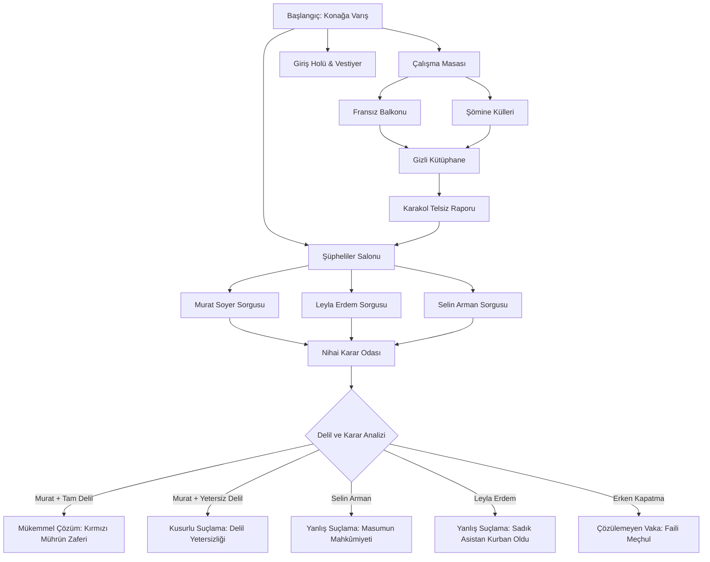

# PlotTwist — İnteraktif Dedektiflik ve Gizem Oyunu

> *"Her ipucu bir sır, her seçim yeni bir son."*

**PlotTwist**, oyuncunun bir başkomiser rolüne büründüğü, delilleri topladığı, şüphelileri çapraz sorguya çektiği ve verdiği kararlarla cinayetin sonucunu belirlediği interaktif bir web tabanlı dedektiflik oyunudur.

Bu proje, modern noir dedektif filmlerinin sinematik atmosferini; saf CSS3, React Hooks ve modüler durum yönetimiyle birleştiren, GitHub portföyü için hazırlanmış tam teşekküllü bir ön yüz (frontend) uygulamasıdır.

---

## 📌 Projenin Amacı

Oyuncuyu karmaşık bir cinayet vakasının içine çekerek hem hikâye anlatımı hem de mantıksal çıkarım mekanikleri sunmak. 

"Kırmızı Mühür" vakasında zengin koleksiyoncu Cem Arman'ın ölümünü aydınlatırken:
- Sıradan tahminlere değil, olay yerinden elde edilen somut fiziksel ve adli delillere dayanmak,
- Şüphelilerin çelişkili ifadelerini deşifre etmek,
- Seçimlerin oluşturduğu dallanan hikâye akışıyla farklı sonlara (Doğru Çözüm, Yanlış Suçlama, Delil Yetersizliği, Faili Meçhul) ulaşmak.

---

## ✨ Temel Özellikler

- **Çoklu Vaka Kütüphanesi & Vaka Seçici:** Oyuncu 3 farklı cinayet vakası arasında seçim yapabilir:
  1. *Kırmızı Mühür* (Boğaz antika köşkü cinayeti)
  2. *Sessiz Sahne* (Şehir Tiyatrosu prömiyerinde başrol cinayeti)
  3. *Gölgeli Galeri* (Pera sanat galerisi soygunu ve zehirleme)
- **Sinematik Noir Tasarımı:** Koyu renk paleti (`#0B0D12`, `#141821`, `#1B202B`), kan kırmızısı balmumu mührü vurgusu (`#C34B53`) ve eskitilmiş altın detaylar (`#D3AD73`).
- **Dinamik Hikâye Grafiği:** Her vaka için dallanan yol ayrımları, olay yerleri ve koşullu karar seçenekleri.
- **Vaka Dosyası (Delil Paneli):** Toplanan kritik kanıtlar, gizli ipuçları ve şüpheli profilleri.
- **Kilitli Seçenek Mekanizması:** Kritik sorgu hamleleri yalnızca ilgili fiziksel deliller toplandığında açılır.
- **Çoklu ve Anlamlı Finaller:** Her vakada Doğru Çözüm, Yanlış Suçlama, Delil Yetersizliği ve Faili Meçhul sonları.
- **Güvenli Kayıt Sistemi (localStorage):** Vaka ilerlemesi otomatik kaydedilir ve bozuk verilere karşı korumalıdır.
- **Erişilebilirlik (A11y):** Klavyeyle tam kontrol (`Tab`, `Enter`, `Escape`), belirgin odaklama halkaları, `prefers-reduced-motion` desteği.

---

## 🛠️ Kullanılan Teknolojiler

- **React 19:** Bileşen tabanlı mimari ve modern reaktif durum yönetimi (`useState`, `useCallback`, `useRef`).
- **Vite 8:** Işık hızında HMR ve optimize edilmiş üretim derlemesi (production build).
- **JavaScript (ES6+):** Temiz, modüler ve fonksiyonel kod yapısı.
- **CSS3 (Vanilla):** CSS Özel Değişkenleri, Grid, Flexbox ve noir efektleri.
- **Web Storage API (localStorage):** Şema doğrulamalı, hata korumalı yerel kayıt mekanizması.
- **Vitest & React Testing Library:** 17 kapsamlı birim ve entegrasyon testi.

---

## 📂 Dosya Yapısı

```
plot-twist/
├── public/                     # Statik varlıklar
├── src/
│   ├── components/             # Yeniden kullanılabilir kullanıcı arayüzü bileşenleri
│   │   ├── Header.jsx          # Üst navigasyon, vaka rozeti ve delil sayacı
│   │   ├── StoryPanel.jsx      # Sahne anlatımı, atmosferik başlık ve karar seçenekleri
│   │   ├── ChoiceButton.jsx    # Kilit korumalı ve klavye destekli karar butonları
│   │   ├── CaseFile.jsx        # İpuçları, şüpheli profilleri ve vaka özeti çekmecesi
│   │   ├── EndingScreen.jsx    # Final değerlendirmesi, karar özeti ve başarı raporu
│   │   └── Modal.jsx           # Erişilebilir ve klavye uyumlu (ESC) diyalog penceresi
│   ├── data/
│   │   └── mysteryStory.js     # Hikâye düğümleri, delil modeli, şüpheliler ve final mantığı
│   ├── hooks/
│   │   └── useGame.js          # Oyun akışı, geçişler ve kayıt senkronizasyonu kancası
│   ├── utils/
│   │   └── storage.js          # Try/catch korumalı ve şema kontrollü localStorage modülü
│   ├── App.jsx                 # Ekran yönetimi (Giriş, Soruşturma, Final)
│   ├── main.jsx                # React başlangıç noktası
│   └── styles.css              # Noir temalı tüm stil, tipografi ve responsive kurallar
├── tests/
│   ├── setup.js                # Testing Library / Jest-DOM yapılandırması
│   ├── gameLogic.test.js       # 9 zorunlu senaryoyu doğrulayan oyun mantığı testleri
│   └── storage.test.js         # Yerel kayıt, bozuk veri ve sıfırlama testleri
├── index.html                  # SEO, Türkçe dil ayarı ve Google Fonts bağlantıları
├── package.json                # Proje bağımlılıkları ve çalıştırma scriptleri
├── vite.config.js              # Vite & Vitest konfigürasyonu
└── README.md                   # Proje dokümantasyonu
```

---

## 🚀 Kurulum ve Çalıştırma

Projeyi yerel ortamınızda çalıştırmak için aşağıdaki adımları takip edin:

### 1. Bağımlılıkları Yükleyin
```bash
npm install
```

### 2. Geliştirme Sunucusunu Başlatın
```bash
npm run dev
```
Sunucu başladığında tarayıcınızda `http://localhost:5173/` adresine gidin.

### 3. Testleri Çalıştırın
```bash
npm run test
```
Tüm birim ve entegrasyon testleri Vitest ile çalıştırılır (16 testin tamamı doğrulanmıştır).

### 4. Canlı (Production) Paketini Oluşturun
```bash
npm run build
```
Derleme çıktısı `dist/` klasörüne oluşturulur.

---

## 🔍 Oyun Mantığı ve Soruşturma Akışı



1. **Kanıtlar (Clues):**
   - *Durmuş Masa Saati (23:15)* — Saatin cinayetten sonra sahte alibi oluşturmak için kırıldığını gösterir.
   - *Konyak Kadehi & Badem Kokusu* — Cem Arman'ın siyanürle zehirlendiğini kanıtlar.
   - *Islak İpek Fular* — Selin'in cinayet gecesi köşkte olduğunu ortaya çıkarır.
   - *Çamurlu Ayak İzleri* — 44 numara İtalyan kösele izleri Murat Soyer'i balkona bağlar.
   - *Şöminedeki Tehdit Notu* — Murat'ın Cem'e yazdığı açık ölüm tehdidini belgeler.
   - *Kırmızı Mühürlü Zarf* — Murat'ın 10 milyon liralık borç senedi ve Cem'in vasiyetidir; Leyla tarafından korunmuştur.
   - *Benzinlik Fişi & Kamera Kaydı* — Selin'in 23:30'da kaçtığını doğrular.

2. **Değerlendirme:**
   - Katil **Murat Soyer**'dir.
   - Ancak oyuncunun doğru sonuca ulaşabilmesi için sadece Murat'ı suçlaması yetmez; kırık saati, siyanür kadehini ve (çamur izi veya tehdit mektubu) içeren en az 4 delili toplamış olması gerekir. Aksi halde Murat delil yetersizliğinden kurtulur!

---

## 🔮 Gelecekte Eklenebilecek Özellikler

- **Zaman Sınırı & Gerilim Modu:** Dedektifin her seçimi bir saat/dakika harcayabilir ve polis şefinin baskısı artabilir.
- **Ses ve Ambiyans Efektleri:** Yağmur sesi, şömine çıtırtısı ve eski plak cızırtısı içeren Web Audio API desteği.
- **Yeni Vakalar:** Farklı cinayet dosyalarının seçilebildiği çoklu vaka kütüphanesi.
- **Başarım Sistemi (Achievements):** "Kusursuz Dedektif", "Hiçbir İzi Kaçırmayan", "Hızlı Hüküm" gibi rozetlerin profilde saklanması.

---

## 📄 Lisans

Bu proje MIT lisansı altında açık kaynak olarak geliştirilmiştir.
